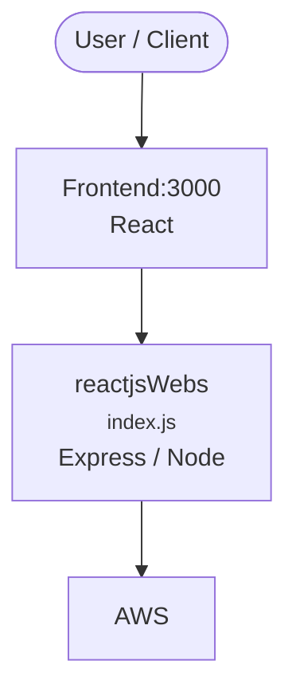

# Context Map — `reactjsWebs`

> Auto-generated architecture & deployment context map. Summarizes the core application, container/cloud footprint, and database connections. Regenerate after significant structural changes.

**Repo:** `avnit/reactjsWebs` · **Original** · Public · Primary language: CSS · Default branch: `master` · Files: 62

**Description:** Sample website with React Js and bootstrap

## 1. Core application

- **Frameworks / runtime:** Express / Node, React
- **Entry points:** `src/client/index.js`, `src/server/index.js`
- **Listens on port(s):** 3000

## 2. Containers & cloud applications

**Detected cloud platforms / services:** AWS

## 3. Database connections

_No database drivers or connection strings detected._

## 4. Architecture diagram

## 5. Security posture

- **Dependabot alerts (open):** 9 critical, 40 high, 36 medium, 14 low

---
_Generated by repo context-mapping pass on 2026-08-13._